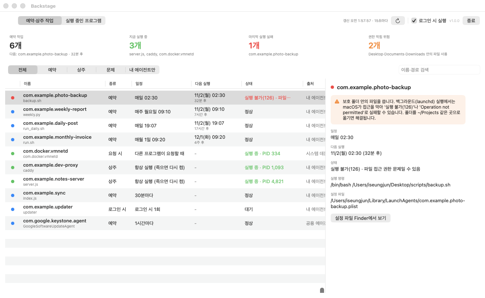

<p align="center"></p>

<h1 align="center">Backstage</h1>

<p align="center">맥의 무대 뒤에서 돌고 있는 것들을 한눈에 보여주는 메뉴바 앱입니다.<br>
예약 작업, 항상 켜져 있는 에이전트, 백그라운드 프로그램이 다음에 언제 도는지, 지난번에 잘 돌았는지 알려 줍니다.</p>

<p align="center"><a href="https://github.com/ESeungJun/backstage/releases/latest/download/Backstage-macOS.dmg"><b>⬇ Mac용 내려받기</b></a><br>
<sub>Apple 실리콘·인텔 모두 · 서명·공증 완료 · macOS 14 이상 · <a href="https://github.com/ESeungJun/backstage/releases">모든 릴리스</a></sub></p>

<p align="center"><a href="README.md">English</a> · <b>한국어</b></p>

<p align="center"></p>

---

매일 저녁 19:07에 인스타그램에 글을 올리는 스크립트를 만들어 두었습니다.
그런데 어느 날 보니 한 번도 올라간 적이 없었습니다. 에러 창도 없었고, 평소 보던 로그에도 아무것도 없었습니다.
알고 보니 macOS가 매일 밤 조용히 막고 있었습니다. 스크립트가 `~/Desktop`에 있었는데,
launchd가 띄우는 백그라운드 작업은 데스크탑·문서·다운로드 폴더를 읽을 수 없게 되어 있었기 때문입니다.

그러다 보니 내 맥에서 시간 맞춰 도는 게 또 뭐가 있는지, 그것들은 제대로 돌고 있는지 궁금해졌습니다.
`launchctl list`를 치면 라벨과 숫자만 잔뜩 나와서, 사람이 읽을 수 있는 말로 보여주는 창을 만들었습니다.

## 보여주는 것

- **예약 작업** — launchd 작업 전부를 일정과 함께 보여 줍니다(`매일 19:07`, `매주 월요일 09:10`, `30분마다`). 다음 실행 시각도 나옵니다.
- **상주 에이전트** — launchd가 계속 켜 두는 작업이 지금 돌고 있는지(PID 포함) 보여 줍니다.
- **지난 실행 결과** — 마지막 종료 코드를 풀어서 보여 줍니다: `정상`, `실행 불가(126) · 파일 접근 권한 문제일 수 있음`, `명령을 찾지 못함(127)`, 신호로 종료 등.
- **권한 함정** — 데스크탑·문서·다운로드 안의 파일을 쓰는 작업은 주황색으로 표시합니다.
  백그라운드에서 왜 실패할 수 있는지, 어떻게 고치는지(폴더를 `~/Projects` 같은 곳으로 옮기기)도 함께 알려 줍니다.
- **상세 정보와 로그** — 작업을 고르면 전체 명령, 작업 폴더, 설정 파일, 로그 마지막 부분이 나옵니다.
  설정 파일을 Finder에서 보거나 로그를 바로 열 수 있습니다.
- **실행 중인 프로그램** — 두 번째 탭에서 내 계정으로 도는 프로그램을 CPU 순으로 보여 줍니다(macOS 시스템 프로세스는 뺍니다).

맨 위 카드 네 장이 한 번에 요약해 줍니다. 예약 작업이 몇 개이고 다음은 무엇인지,
지금 무엇이 돌고 있는지, 지난번에 무엇이 실패했는지, 무엇이 권한 때문에 막힐 수 있는지.

## 메뉴바에 두고 쓰는 앱

- **클릭 한 번** — 메뉴바의 시계 아이콘을 누르면 넓은 패널이 열리고, 바깥을 누르면 닫힙니다. Dock 아이콘도, 따로 관리할 창도 없습니다.
- **고장 나면 알려 줌** — 지난 실행이 실패한 작업이 있으면 메뉴바 아이콘이 경고 표시와 개수로 바뀝니다.
- **늘 최신** — 15초마다 새로 읽습니다(⌘R로 바로 새로고침).
- **로그인 시 실행** — 처음 켤 때 자동으로 켜집니다. 패널의 `로그인 시 실행`을 끄면 꺼집니다.
- **읽기 전용** — 작업을 켜거나, 끄거나, 고치거나, 지우지 않습니다. plist, `launchctl`, `ps`만 읽습니다.

## 설치

[`Backstage-macOS.dmg`](https://github.com/ESeungJun/backstage/releases/latest/download/Backstage-macOS.dmg)를 내려받아 열고,
`Backstage.app`을 응용 프로그램 폴더로 끌어다 놓으면 됩니다.
파일 하나로 Apple 실리콘과 인텔 맥 모두에서 돌아갑니다.
Developer ID로 서명하고 Apple 공증을 받았기 때문에 경고 없이 열립니다.

macOS 14 이상이 필요하고, 따로 허락할 권한은 없습니다.
실행하면 메뉴바에 시계 아이콘이 생깁니다(Dock 아이콘은 없습니다).

Backstage는 macOS 전용입니다. macOS가 백그라운드 작업을 돌리는 방식인 launchd를 읽는 앱이기 때문입니다.

## 만든 방법

- **SwiftUI + AppKit**, 파일 하나(`Sources/main.swift`)에 외부 의존성 없이 만들었습니다.
  메뉴바 아이콘은 `NSStatusItem`과 `NSPopover`, 로그인 시 실행은 `SMAppService`를 씁니다.
- 일정은 `~/Library/LaunchAgents`, `/Library/LaunchAgents`, `/Library/LaunchDaemons`의 plist에서 바로 읽습니다.
  상태는 `launchctl list` / `launchctl print`, 프로세스는 `ps`에서 가져옵니다.

Claude Code와 함께 만들었습니다.

## 개발

```bash
./build.sh               # build/Backstage.app (유니버설, ad-hoc 서명)
./build.sh --install     # 빌드한 뒤 ~/Applications 에 복사하고 실행
open build/Backstage.app --args --demo --window   # 예시 데이터를 일반 창으로 (스크린샷용)
```

<details>
<summary>프로젝트 구성과 릴리스</summary>

| 경로 | 역할 |
|---|---|
| `Sources/main.swift` | 앱 전체: plist 해석, 일정 문장, 상태, 화면, 메뉴바 |
| `build.sh` | arm64·x86_64로 컴파일해 합치고, 아이콘과 Info.plist를 만들고, 서명 |
| `tools/make_icon.swift` | 앱 아이콘(`docs/images/icon-1024.png`)을 그림 |
| `VERSION` | 앱 버전. 릴리스 태그와 같아야 함(`v1.0.0`) |

`v*` 태그를 push하면 GitHub Actions가 유니버설 앱을 빌드하고, 하드닝 런타임으로 Developer ID 서명을 합니다.
그다음 앱과 DMG를 각각 공증받아 티켓을 붙이고, `Backstage-macOS.dmg`를 릴리스로 올립니다.
필요한 Secrets: `MAC_CERT_P12`, `MAC_CERT_PASSWORD`, `APPLE_API_KEY_P8`, `APPLE_API_KEY_ID`, `APPLE_API_ISSUER`.

</details>
