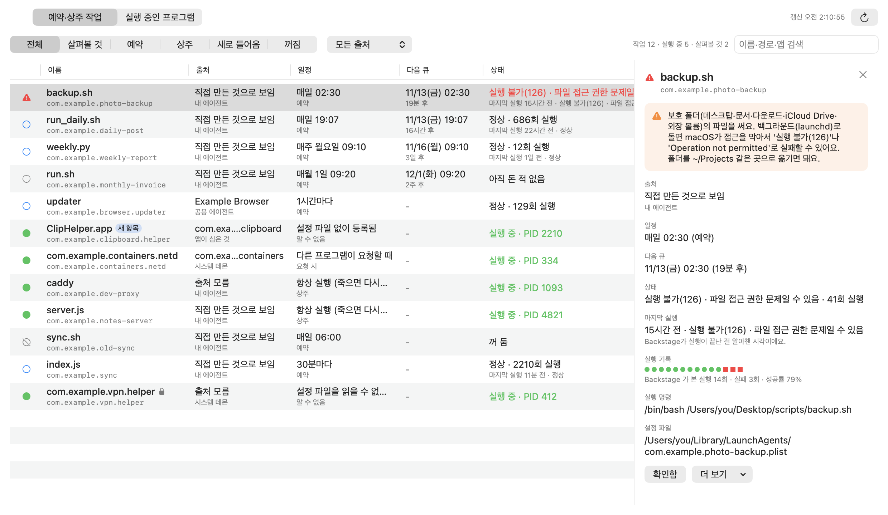
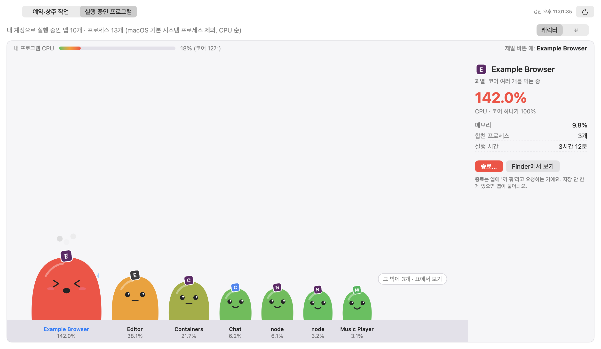
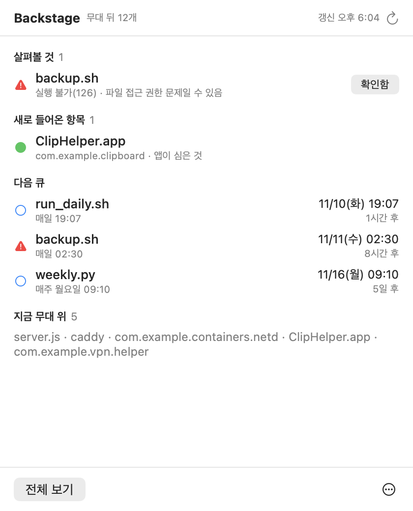

<p align="center"></p>

<h1 align="center">Backstage</h1>

<p align="center">A menu bar app that shows everything running behind the curtain on your Mac.<br>
Scheduled jobs, always-on agents and background programs, with when they run next and whether the last run worked.</p>

<p align="center"><a href="https://github.com/ESeungJun/backstage/releases/latest/download/Backstage-macOS.dmg"><b>⬇ Download for Mac</b></a><br>
<sub>Apple silicon and Intel · signed and notarized · macOS 14+ · <a href="https://github.com/ESeungJun/backstage/releases">All releases</a></sub></p>

<p align="center"><b>English</b> · <a href="README.ko.md">한국어</a></p>

<p align="center"></p>

---

Backstage is a small tool for checking on background tasks.
macOS runs a lot of things on a timer or keeps them alive in the background through launchd,
but `launchctl list` only answers in a wall of labels and numbers.
Backstage reads the same information and shows it in plain words: what runs when, what's running now, and what failed.

## What it shows

- **Scheduled jobs** — the schedule written out (`Every day 19:07`, `Every Monday 09:10`, `Every 30 minutes`)
  and when it will run next.
- **Always-on agents** — jobs that launchd keeps alive, and whether they're running right now (with their PID).
- **Items planted by apps** — things that have no file in the `LaunchAgents` / `LaunchDaemons` folders are listed too:
  agents embedded in an app bundle (`SMAppService`) and services a program registered while running.
  `com.apple.*`, the built-in services under `/System`, and apps you launched normally are left out.
- **Who put it there** — each item shows the app it came from, by name and icon. Your own agents that run a script in your home folder
  are marked as self-made, and items whose app is gone are marked as orphaned.
- **Honest status** — running, OK with the run count, never ran, switched off, interrupted (the signal sent at logout or restart),
  `couldn't run (126) · possibly a file permission problem`, `command not found (127)` and so on.
  A job that was registered but never ran is no longer reported as OK.
- **Run history** — launchd doesn't say when a job last ran. While it's open, Backstage watches the run counts and keeps its own record
  of the runs it saw (when it noticed the run had ended, and the exit code), then shows the last run, the last 14 results and the success rate.
  Until there is a record, it shows when the log file last changed instead.
- **New arrivals** — the first list it sees becomes the baseline; anything that appears later is tagged as new for 7 days.
  A system notification is available too (off by default).
- **Unreadable settings files** — daemon plists that only an administrator can read stay in the list, marked with a lock,
  with status and program filled in from `launchctl`.
- **Permission traps** — jobs that use files in Desktop, Documents, Downloads, iCloud Drive or an external volume are flagged in orange,
  with a note on why they can fail in the background and how to fix it (move the folder somewhere like `~/Projects`).
- **Details and logs** — pick a job to see its full command, working folder and settings file and the last lines of its log;
  reveal the plist in Finder, open the log, or copy the command to inspect it yourself (`launchctl print …`).
- **Search and filters** — search by name, path or app, and filter by needs-a-look, scheduled, always-on, new, off, or by source.
- **Running programs** — a second tab shows each app running under your account as a little jelly character: the more CPU it uses, the fatter it gets.
  It dozes when idle, sweats past 50%, and steams past 100% (one core = 100%). Helper processes are added to their app, and the macOS system processes are left out.
  Pick one to see its CPU, memory and running time, or switch to the table for every process.
- **Quit a program** — press `종료…` and confirm. An app is asked to quit normally (it can still ask you to save); any other program gets `SIGTERM`.
  If it is still running after 5 seconds, you can choose to force quit. macOS system programs and Backstage itself have no quit button.
  The animation runs in Core Animation, so watching CPU doesn't cost CPU, and it stops with Reduce Motion on.

## Made to sit in the menu bar

- **One click** — click the menu bar icon and a small summary drops down: what needs a look, new arrivals, the next cues, and what's on stage now.
  `전체 보기` opens a window with every job. No Dock icon.
- **It only speaks up when there's something to see** — the menu bar icon turns into a warning sign with a count only when one of your own agents failed.
  Failed third-party daemons and logout signals don't count. Press `확인함` to dismiss a failure; it comes back if the job fails again.
- **Quiet refresh** — it reads when you open the summary or the window, every 30 seconds while one is open, and every 5 minutes otherwise (or press ⌘R).
- **Launch at login** — it asks once, the first time you open it. You can switch it any time from the `⋯` menu.
- **Read-only for jobs** — it never starts, stops, edits or deletes a job. It only reads plists, `launchctl print` and `ps`.
  The one thing it can stop is a running program you pick and confirm in the running programs tab.
  The only things it writes are its own records (run history and baseline in `~/Library/Application Support/Backstage/`) and preferences.

<p align="center"></p>

<p align="center"></p>

## Install

Download [`Backstage-macOS.dmg`](https://github.com/ESeungJun/backstage/releases/latest/download/Backstage-macOS.dmg),
open it and drag `Backstage.app` into Applications.
One file works on both Apple silicon and Intel Macs.
It's signed with a Developer ID and notarized by Apple, so it opens without any warning.

Requires macOS 14 or later. No permissions are needed. The interface is in Korean.
A curtain icon appears in the menu bar; the app has no Dock icon.

Backstage is macOS only: it reads launchd, which is how macOS runs background jobs.

## Built with

- **SwiftUI + AppKit** as a Swift Package with no dependencies:
  `BackstageCore` (models, parsing, collection; Foundation only) and `Backstage` (UI and menu bar).
  The menu bar icon is an `NSStatusItem` with an `NSPopover`; launch at login uses `SMAppService`.
- Schedules come from the launchd plists in `~/Library/LaunchAgents`, `/Library/LaunchAgents` and `/Library/LaunchDaemons`;
  status comes from `launchctl print gui/<uid>` and `launchctl print system` (once per domain) plus per-service `launchctl print`,
  and processes from `ps`. Services still running under the same PID are not queried again.

Built together with Claude Code.

## Development

```bash
swift build              # debug build
swift test               # parser and model tests (without XCTest: DEVELOPER_DIR=/Applications/Xcode.app/Contents/Developer)
./build.sh               # build/Backstage.app (universal, ad-hoc signed)
./build.sh --install     # build, copy to ~/Applications and launch
open build/Backstage.app --args --demo --window   # sample data in the full window (add --procs for the running programs tab)
.build/debug/Backstage --probe                    # no UI: process count and time of one collection
.build/debug/Backstage --snapshot <dir>           # render the sample screens to PNG without showing them (README images; --dark for dark mode)
```

<details>
<summary>Project layout and releases</summary>

| Path | Role |
|---|---|
| `Sources/BackstageCore` | Parsing of plists and `launchctl` output, schedule wording, status, collection, run history, grouping processes by app |
| `Sources/Backstage` | Menu bar icon, summary panel, full window, CPU characters (`ProcsView`) and quitting programs (`Quitter`) |
| `Tests/BackstageCoreTests` | Fixtures of `launchctl` output with made-up labels, and the tests |
| `build.sh` | Runs `swift build` for arm64 and x86_64, merges them, makes the icon and Info.plist, signs |
| `tools/make_icon.swift` | Draws the app icon (`docs/images/icon-1024.png`) |
| `VERSION` | App version; a release tag must match it (`v1.1.0`) |

Every push and pull request runs `swift build` and `swift test` (`.github/workflows/ci.yml`).
Pushing a `v*` tag makes GitHub Actions build the universal app, sign it with a Developer ID with the hardened runtime,
notarize and staple both the app and the DMG, and publish `Backstage-macOS.dmg` as a release.
Required secrets: `MAC_CERT_P12`, `MAC_CERT_PASSWORD`, `APPLE_API_KEY_P8`, `APPLE_API_KEY_ID`, `APPLE_API_ISSUER`.

</details>
