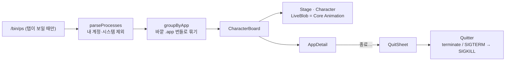
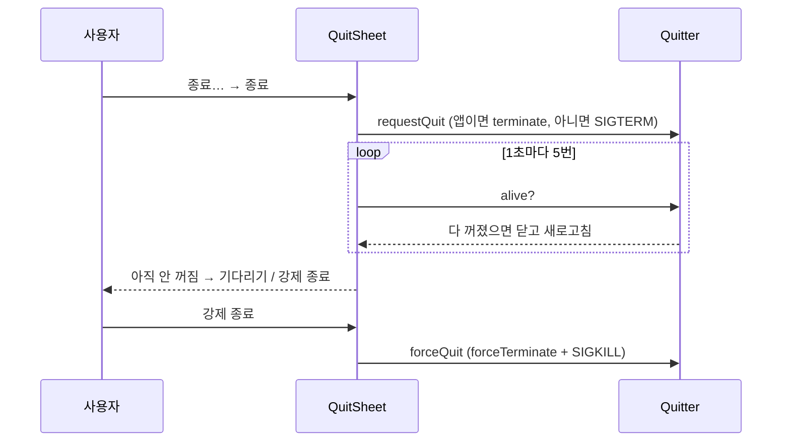

# 설계서

## 실행 중인 프로그램: CPU 캐릭터와 프로그램 끄기 (2026-11-12)

### 무엇을
- '실행 중인 프로그램' 탭을 캐릭터 화면으로 바꾼다. 앱 하나가 캐릭터 하나이고, CPU를 많이 쓸수록 뚱뚱해진다. 표는 `캐릭터 | 표` 토글로 남긴다.
- 고른 앱을 끌 수 있다. 확인 → 정상 종료 요청 → 5초 안에 안 꺼지면 강제 종료를 고를 수 있다.

### 구조

| 층 | 파일 | 하는 일 |
|---|---|---|
| Core | `BackstageCore/AppGroups.swift` | `AppGroup`, `groupByApp`, `parseElapsed`·`describeElapsed`, `CPUMood`, `canQuit`, `sameProgram` (모두 테스트) |
| 화면 | `Backstage/ProcsView.swift` | 탭, 요약 줄, 무대, 캐릭터 그리기(`BlobPainter`), 상세 칸, 확인창, 색(`Palette`)·아이콘(`AppIcon`) |
| 끄기 | `Backstage/Quitter.swift` | `NSRunningApplication.terminate()` 또는 `SIGTERM`, 강제는 `forceTerminate()`·`SIGKILL` |

### 끄기 흐름

### 지켜야 할 것
- **PID 재사용**: 신호를 보내기 전에 `proc_pidpath`로 그 PID가 아직 같은 프로그램인지 본다. ps는 링크를 안 푼 경로(`/tmp`, `/opt/homebrew/bin/node`)를, 커널은 푼 경로를 주므로 실행 파일 이름으로 비교한다.
- **끄지 않는 것**: `/System/`·`/usr/`·`/bin/`·`/sbin/`·`/Library/Apple/` 아래 프로그램, Backstage 자신. 다른 계정의 프로세스는 처음부터 목록에 없다.
- **CPU를 보는 화면이 CPU를 먹지 않게**: 몸은 그림 한 장으로 굽고, 숨쉬기·떨기·땀·김·zz는 Core Animation 애니메이션으로 창 서버에서 돈다. SwiftUI로 매 프레임 그렸을 때 릴리스 빌드에서 코어 하나의 11~14%를 썼고, 지금은 0%로 잰다.
- **동작 줄이기**: 켜져 있으면 움직이지 않는 그림 한 장만 그린다. `--snapshot`도 같은 정지 그림을 쓴다.
- ps는 탭이 보일 때만 돈다(기존과 같음). 끈 뒤에는 바로 새로 읽는다.
